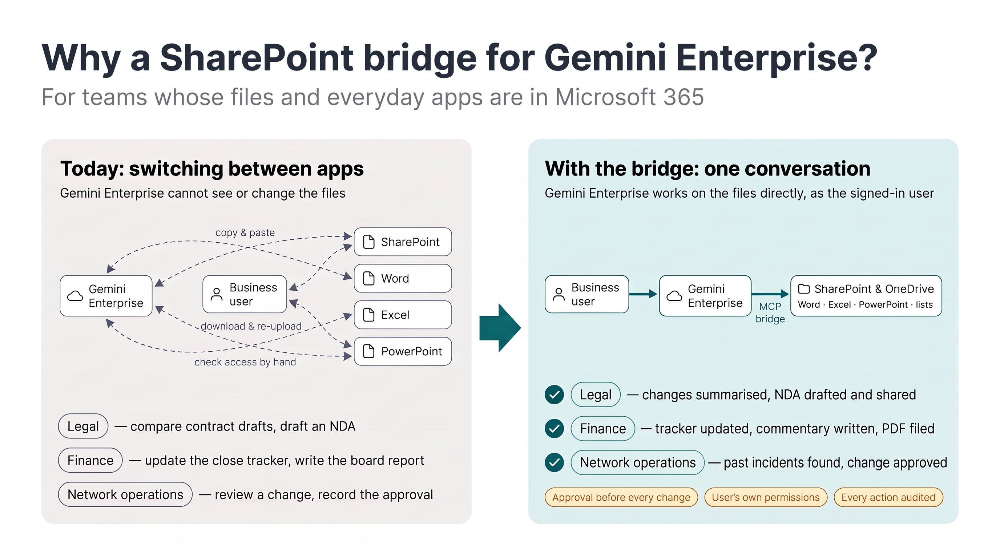
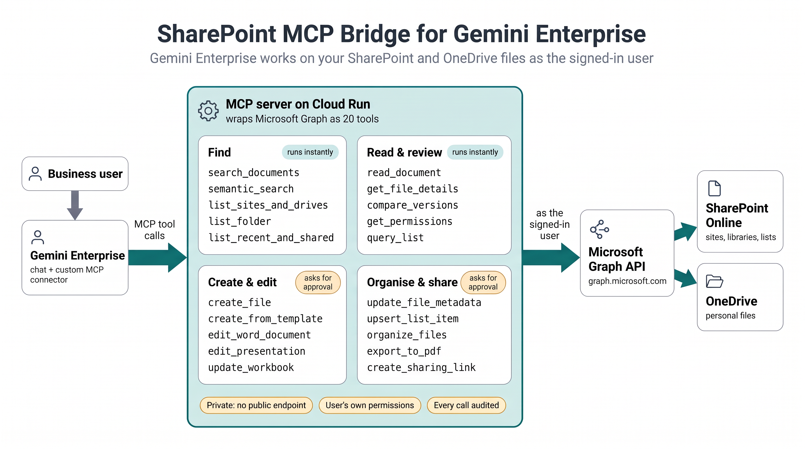
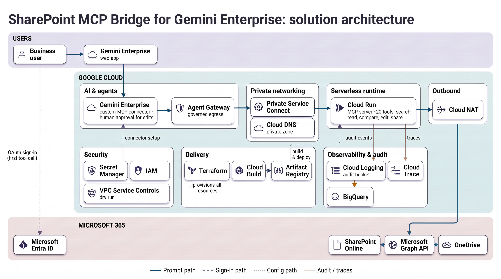
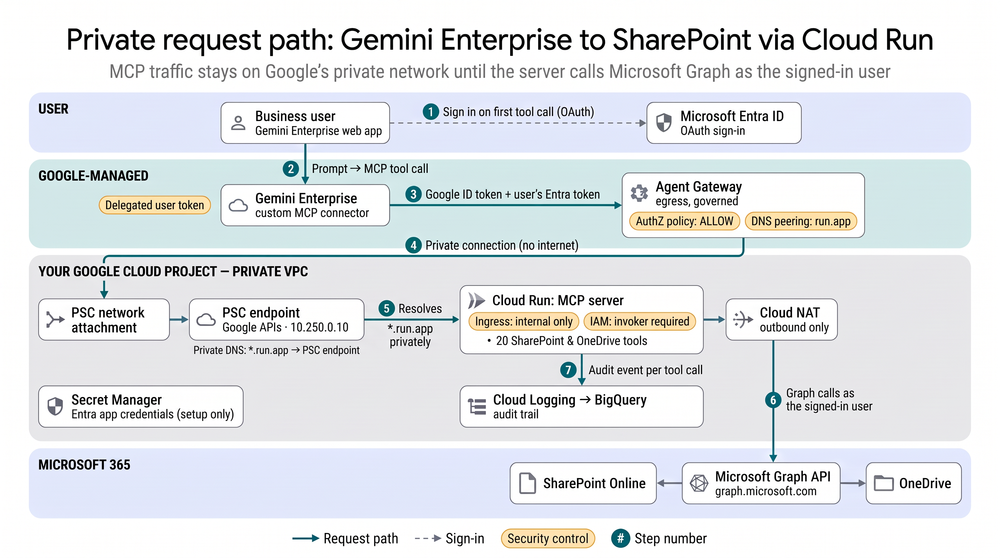

# SharePoint MCP Bridge for Gemini Enterprise

**Connect Gemini Enterprise to the documents your organisation keeps in Microsoft 365.**
This bridge lets Gemini Enterprise search, read, compare, draft, edit, organise and share SharePoint Online and OneDrive content **as the signed-in user**, through a private [Model Context Protocol](https://modelcontextprotocol.io) server on Cloud Run that has no public endpoint.

[](docs/why.png)

- **20 MCP tools**, written generically so you can adapt them: search (keyword and semantic), full-document reading, version comparison, permission review, templated drafting, in-place Word / Excel / PowerPoint editing, file metadata, SharePoint lists, filing, PDF export, and sharing links.
- **Private by design.** Gemini Enterprise reaches Cloud Run through an egress Agent Gateway and Private Service Connect. Cloud Run has internal-only ingress *and* IAM enforcement.
- **The user's own permissions.** Every Microsoft Graph call uses the user's delegated Entra ID token, so Gemini sees and changes exactly what that person could in SharePoint.
- **Human approval for writes.** Read tools run straight away; every tool that changes something asks the user first.
- **Audited.** Every tool call writes one structured event (who, what, which file, outcome) to a dedicated log bucket linked to BigQuery.
- **Ready for VPC Service Controls**, with a dry-run perimeter and a local dashboard that groups violations by the change needed to resolve them.

---

## Contents
1. [Who it's for](#1-who-its-for)
2. [Architecture](#2-architecture)
3. [Tool catalog](#3-tool-catalog)
4. [Setup](#4-setup)
5. [Demo walkthrough](#5-demo-walkthrough)
6. [Audit trail](#6-audit-trail)
7. [VPC Service Controls (dry run)](#7-vpc-service-controls-dry-run)
8. [Lessons learned](#8-lessons-learned)
9. [Local development](#9-local-development)
10. [Repository layout](#10-repository-layout)

---

## 1. Who it's for

Organisations that use Gemini Enterprise and keep their documents, trackers and approvals in Microsoft 365. The four stories below use a fictional company, **Halcyon Group**, and the demo files in [`demo_assets/`](demo_assets/). Each one maps to a short demo segment of two or three prompts ([section 5](#5-demo-walkthrough)); together they show 16 of the 20 tools in about 8 minutes.

### Legal: "The contract desk"
**Who:** in-house counsel and legal operations.
**Today:** contracts are spread across SharePoint matter folders. Spotting what changed between drafts, producing a first-pass NDA, keeping contract metadata current and checking who can see a matter all mean opening SharePoint, Word and email side by side.
**With the bridge:** counsel finds the latest Fabrikam MSA and gets a plain-English summary of what changed since v3 (liability cap halved, notice period cut, new data-protection clause), generates an NDA for a new counterparty from the firm's template with *Contract Status* and *Expiry Date* set, then shares it and confirms who now has access, in three prompts.
**Tools:** `search_documents`, `compare_versions`, `create_from_template`, `update_file_metadata`, `create_sharing_link`, `get_permissions`.

### Finance: "Month-end close in one conversation"
**Who:** controllers and FP&A analysts.
**Today:** the close tracker is in Excel, the variance commentary is in Word, the board pack is distributed as a PDF, and each step involves copying content between applications.
**With the bridge:** the controller asks what's still open on the October close and updates the tracker in one approved edit, then has Gemini draft the variance commentary straight into the board report (keeping the corporate template) and save a PDF into the board-pack folder, in two prompts.
**Tools:** `read_document`, `update_workbook`, `edit_word_document`, `export_to_pdf`.

### Telco / network operations: "Change approval"
**Who:** network operations and change managers running a Change Advisory Board (CAB).
**Today:** reviewing a risky change means reading the change register list, the method statement and old incident reviews one by one before the CAB meeting.
**With the bridge:** the change manager lists the high-risk changes awaiting approval, asks whether similar upgrades have caused incidents before (semantic search surfaces a past BGP outage) and whether CHG-1042's method statement covers those lessons, then approves the change with a condition on the list item and adds a decision slide to the CAB deck, in two prompts.
**Tools:** `query_list`, `read_document`, `semantic_search`, `upsert_list_item`, `edit_presentation`.

### Security & platform teams: "Deployment assurance"
**Who:** the CISO, cloud platform teams and Microsoft 365 administrators who approve the deployment.
**What they can verify:**
- There is no public endpoint. Cloud Run accepts only internal traffic, and only from the Gemini Enterprise service agent.
- Users can access only what they could already access. A second user requesting the same contract is denied, because Microsoft 365 does not grant them access.
- Every change requires explicit user approval, and anonymous sharing links are disabled unless an administrator enables them.
- Every action is in BigQuery with the user's Entra object ID, the file, the outcome and the latency.
- A VPC Service Controls dry run shows that the runtime path needs no perimeter exceptions; only user access and the build pipeline do.

> These stories are illustrative rather than exhaustive. The tools are deliberately generic (files, lists, metadata, versions, permissions), so the same building blocks cover HR policies, procurement, engineering change control, audit evidence collection and more. Changing a story usually means changing the prompt, not the code.

---

## 2. Architecture

### 2.1 At a glance
Gemini Enterprise calls the MCP server on Cloud Run, which wraps Microsoft Graph as 20 tools and works on SharePoint and OneDrive as the signed-in user. Read tools run straight away; tools that change something ask first.

[](docs/overview.png)

### 2.2 Solution architecture
[](docs/solution_architecture.png)

| Area | Services | Role |
| :--- | :--- | :--- |
| AI & agents | Gemini Enterprise, Agent Gateway | Chat, custom MCP connector, human approval for writes, governed egress |
| Runtime | Cloud Run | The MCP server (20 tools) |
| Private networking | Private Service Connect, Cloud DNS, Cloud NAT | Private path into the VPC, private `run.app` resolution, controlled outbound to Microsoft Graph |
| Security | IAM, Secret Manager, VPC Service Controls (dry run) | Caller authorisation, Entra app credentials, perimeter readiness |
| Delivery | Terraform, Cloud Build, Artifact Registry | Infrastructure as code, tested image builds and rollouts |
| Observability | Cloud Logging, BigQuery, Cloud Trace | Per-user audit trail, analytics, tracing |

### 2.3 Private request path
[](docs/network_flow.png)

| Step | What happens |
| :-: | :--- |
| 1 | On the first tool call, the user signs in to **Microsoft Entra ID** (OAuth authorisation code flow). Gemini Enterprise stores the user's delegated token. |
| 2 | The user's prompt makes Gemini Enterprise call a tool on the **custom MCP connector**. |
| 3 | The connector sends the MCP request with two tokens: a **Google ID token** (`X-Serverless-Authorization`) for Cloud Run IAM, and the **user's Entra token** (`Authorization`) for Microsoft Graph. Because the connector has `use_agent_gateway_egress: true`, the request goes to the app's **egress Agent Gateway**. |
| 4 | The gateway checks its **authorisation policy** (ALLOW), resolves `*.run.app` through **DNS peering** with your VPC, and enters the VPC through a **PSC network attachment**. The request never touches the public internet. |
| 5 | The private zone resolves `*.run.app` to the **PSC endpoint for Google APIs** (`10.250.0.10` by default). Cloud Run treats the call as internal and accepts it only if the Google ID token belongs to an identity with `roles/run.invoker`. |
| 6 | The MCP server calls **Microsoft Graph** as the signed-in user, out through **Cloud NAT**. SharePoint and OneDrive permissions apply exactly as they would for that person. |
| 7 | Every tool call writes one **audit event** to a dedicated log bucket that is linked to **BigQuery**. |

### 2.4 Three independent security layers
1. **Network.** Cloud Run ingress is `internal`, so it is not reachable from the internet. Gemini Enterprise reaches it only through the Agent Gateway and Private Service Connect.
2. **Google IAM.** Unauthenticated calls are refused. Only the Gemini Enterprise service agent (`service-<PROJECT_NUMBER>@gcp-sa-discoveryengine.iam.gserviceaccount.com`) holds `roles/run.invoker`, so other workloads in the same VPC get `403`. The design never uses `--no-invoker-iam-check`.
3. **User identity.** Every Graph call carries the user's delegated Entra token. The bridge has no standing access to Microsoft 365 of its own.

> [!NOTE]
> **Regions and data residency.** A Gemini Enterprise app in the `global` location needs its egress Agent Gateway in `us-central1`. Cloud Run can run in another region (set `region`); requests then pass through `us-central1` first. For an EU-only path, create the app in the `eu` location with a gateway in an EU region and validate it before you rely on it.

---

## 3. Tool catalog

Every file tool accepts `drive="onedrive"`, `drive="sharepoint"` (the root site's default library) or a raw drive ID, plus a `file_name` (optionally with `folder_path`) or an `item_id`. The server resolves IDs itself, so Gemini doesn't need extra lookups. SharePoint and OneDrive share the same Graph file APIs; only lists and custom columns are SharePoint-only.

**Read tools** (`readOnlyHint: true`, so Gemini Enterprise runs them without asking)

| Tool | What it does |
| :--- | :--- |
| `search_documents` | Keyword (KQL) search across SharePoint and OneDrive. Falls back to a live folder scan when the Microsoft 365 index hasn't caught up yet. |
| `semantic_search` | Meaning-based passage retrieval through the Microsoft 365 Copilot Retrieval API. Falls back to keyword search if the user has no Copilot licence. |
| `list_sites_and_drives` | Sites, their document libraries and the user's OneDrive. |
| `list_folder` | Files and folders in a library or folder. |
| `list_recent_and_shared` | The user's recent files and files shared with them. |
| `read_document` | Full text of `.docx`, `.xlsx`, `.pptx`, `.pdf`, `.md`, `.txt`, `.csv`, `.json` (headings, tables, sheets, slides). |
| `get_file_details` | Size, owner, modified by, link, SharePoint column values, sensitivity label, version history. |
| `compare_versions` | A diff of two versions of one file (default: previous vs current) or of two different files. |
| `get_permissions` | Who has access and how (people, groups, link scope, inherited), with anonymous links flagged as oversharing risks. |
| `query_list` | Items in a SharePoint list, with an optional OData filter. *SharePoint only.* |

**Write tools** (`readOnlyHint: false`, so Gemini Enterprise asks the user to approve each call)

| Tool | What it does |
| :--- | :--- |
| `create_file` | Creates a `.docx`, `.xlsx`, `.pptx`, `.md`, `.txt` or `.csv` from text, rows or slide outlines. |
| `create_from_template` | Copies a Word / PowerPoint / Excel template and fills its `{{placeholders}}`, and reports any that are left unfilled. |
| `edit_word_document` | Find and replace that keeps run formatting, appends headings and paragraphs, and adds table rows, all in one call. |
| `edit_presentation` | Find and replace on slides (keeping fonts) and appends bullet slides. |
| `update_workbook` | One call can update cells, append rows, add a sheet, add a column and create a table, or create the workbook if it's missing. |
| `update_file_metadata` | Sets SharePoint column values on a document (status, owner, dates). *SharePoint only.* |
| `upsert_list_item` | Creates or updates a SharePoint list item. *SharePoint only.* |
| `organize_files` | Creates a folder, or moves, copies or renames a file. |
| `export_to_pdf` | Saves a PDF copy of an Office document next to it or in another folder. |
| `create_sharing_link` | Creates a view or edit link (organisation scope by default) or invites named people. Anonymous links are refused unless `allow_anonymous_links = true`. |

Microsoft Graph delegated permissions: `Files.ReadWrite.All`, `Sites.ReadWrite.All`, `offline_access`. If you only want reading, drop the write tools and use `Files.Read.All` / `Sites.Read.All`.

---

## 4. Setup

### Prerequisites
- A Google Cloud project with billing and Gemini Enterprise available.
- `gcloud`, [Terraform](https://developer.hashicorp.com/terraform/install) >= 1.6 and [`uv`](https://docs.astral.sh/uv/).
- A Microsoft 365 tenant where you can register an app. A [Microsoft 365 developer sandbox](https://developer.microsoft.com/microsoft-365/dev-program) or a Business trial is suitable for testing.

```bash
export PROJECT_ID="your-project-id"
```

### Step 1: Microsoft 365 tenant
1. Sign in to `https://www.office.com` as a tenant user and open **OneDrive** and **SharePoint** once. This finishes provisioning the personal OneDrive and the root team site.
2. Find your tenant ID without opening the Azure portal:
   ```bash
   curl -s https://login.microsoftonline.com/<your-domain>.onmicrosoft.com/v2.0/.well-known/openid-configuration \
     | python3 -c "import sys, json; print(json.load(sys.stdin)['issuer'].split('/')[3])"
   ```

### Step 2: Register the Entra ID app
In **[entra.microsoft.com](https://entra.microsoft.com)**, go to **App registrations** > **New registration**:
1. **Name:** `Gemini Enterprise SharePoint Bridge`. **Account types:** single tenant.
2. **Redirect URIs (Web).** Add both:
   - `https://vertexaisearch.cloud.google.com/oauth-redirect` (end users signing in from Gemini Enterprise)
   - `https://vertexaisearch.cloud.google.com/console/oauth/default_oauth.html` (the admin **Verify** button in the Cloud console)
3. Copy the **Application (client) ID** and **Directory (tenant) ID** from **Overview**.
4. Under **Certificates & secrets**, create a client secret and copy its **Value** (not the ID).
5. Under **API permissions** > **Microsoft Graph** > **Delegated**, add `Files.ReadWrite.All`, `Sites.ReadWrite.All` and `offline_access`, then click **Grant admin consent**.

### Step 3: Organisation policies
If your organisation restricts Gemini Enterprise connectors, allow custom MCP for this project:
```bash
gcloud resource-manager org-policies disable-enforce \
  discoveryengine.managed.disableCustomMcpServerConnector --project="${PROJECT_ID}"
```
If `discoveryengine.managed.allowedDataSources` is set, it must include `custom_mcp`. If `discoveryengine.managed.allowedEgressFqdns` is set, it must allow your `*.run.app` host and `login.microsoftonline.com`.

### Step 4: Infrastructure (Terraform)

| File | What it creates |
| :--- | :--- |
| [`main.tf`](terraform/main.tf) | APIs, service identities, service-agent roles for the private path, runtime service account, Entra secrets |
| [`network.tf`](terraform/network.tf) | VPC, Cloud Run subnet, gateway subnet and PSC network attachment, PSC endpoint for Google APIs, private `run.app` zone, firewall rule, Cloud Router and NAT |
| [`gateway.tf`](terraform/gateway.tf) | Egress Agent Gateway (DNS peering for `run.app.`) and its ALLOW authorisation policy |
| [`run.tf`](terraform/run.tf) | Artifact Registry, Cloud Run (internal ingress, IAM required, all egress through the VPC), invoker binding, Cloud Build rollout rights |
| [`logging.tf`](terraform/logging.tf) | Audit bucket (Log Analytics on, 365 days), linked BigQuery dataset, sink |
| [`vpc-sc/`](terraform/vpc-sc/) | Separate, optional root module: dry-run perimeter ([section 7](#7-vpc-service-controls-dry-run)) |

State lives in a GCS bucket you create once (versioned, so you can roll back a bad state write):
```bash
gcloud storage buckets create "gs://${PROJECT_ID}-tfstate" --project="${PROJECT_ID}" --location=us-central1 \
  --uniform-bucket-level-access --public-access-prevention
gcloud storage buckets update "gs://${PROJECT_ID}-tfstate" --versioning
```
```bash
terraform -chdir=terraform init -backend-config=bucket="${PROJECT_ID}-tfstate" -backend-config=prefix=ge-sharepoint-mcp-bridge
terraform -chdir=terraform apply -var project_id="${PROJECT_ID}"
```
Every name starts with `prefix` (default `spmcp`), so you can run several copies in one project. Cloud Run starts with a placeholder image. Build and roll out the real one:
```bash
gcloud builds submit --project="${PROJECT_ID}" --region=us-central1 --config=cloudbuild.yaml .
```

### Step 5: Store the Entra credentials
```bash
printf '%s' "<client-id>"     | gcloud secrets versions add spmcp-entra-client-id     --project="${PROJECT_ID}" --data-file=-
printf '%s' "<client-secret>" | gcloud secrets versions add spmcp-entra-client-secret --project="${PROJECT_ID}" --data-file=-
printf '%s' "<tenant-id>"     | gcloud secrets versions add spmcp-entra-tenant-id     --project="${PROJECT_ID}" --data-file=-
```

### Step 6: Create the app, bind the gateway, register the connector
The Terraform provider doesn't cover these Gemini Enterprise settings yet, so a script does it. It reads the Entra values from Secret Manager in memory and builds the tool list from the server code:
```bash
uv run python scripts/register_connector.py \
  --project-id "${PROJECT_ID}" \
  --mcp-server-url "$(terraform -chdir=terraform output -raw mcp_server_url)" \
  --agent-gateway  "$(terraform -chdir=terraform output -raw agent_gateway)"
```
It creates the Gemini Enterprise app `spmcp-app` if it doesn't exist, binds the egress gateway to it, then creates the `custom_mcp` connector with `use_agent_gateway_egress: true`. Add `--dry-run` to print the payload (with the secret redacted) first.

### Step 7: First call
Open the app in the Cloud console (**Gemini Enterprise** > your app > **Integration** > web app URL), ask *"List my SharePoint sites and OneDrive"*, and click **Authorize** to sign in with your Microsoft account.

To confirm the private path, open **Logs Explorer** and query `logName:"networkservices.googleapis.com%2Fgateway_requests"`. You should see `authzPolicyInfo.result: ALLOWED`, `serverIp: 10.250.0.10:443` and `status: 200`.

---

## 5. Demo walkthrough

### 5.1 Load the demo files
[`demo_assets/`](demo_assets/) holds fictional Halcyon Group files (regenerate them with `uv run python scripts/generate_demo_files.py`), plus [`Halcyon_Demo_Files.zip`](demo_assets/Halcyon_Demo_Files.zip) containing all of them. On GitHub, use **Download raw file**.

In the root SharePoint site's **Documents** library:
1. Upload the folders `Legal`, `Finance` and `Network Ops` as they are (**Upload** > **Folder**, or drag them in). `demo_assets/` and the zip use the same layout as the library:
   - `Legal`: `NDA_Template.docx`, `Fabrikam_MSA_v3.docx`, `Fabrikam_MSA_v4.docx`
   - `Finance`: `October_Close_Tracker.xlsx`, `Board_Report_October.docx`
   - `Network Ops`: `CHG-1042_Method_Statement.docx`, `Incident_Review_Core_Router_Upgrade.docx`, `CAB_Review_Week_43.pptx`
2. For legal prompt L2 (setting contract status and expiry date), add two library columns: **Choice** `ContractStatus` (Draft, Under Review, Signed) and **Date** `ExpiryDate`. Create them without spaces so the internal names stay readable (you can rename the display name afterwards).
3. For the telco story, go to **New** > **List** > **From Excel**, upload `Lists/Change_Register.xlsx` (not a library folder) and name the list **Change Register**.

Give the index a few minutes after uploading; until it catches up, `search_documents` falls back to a live scan.

### 5.2 Prompts
Run them in order in one chat, about 8 minutes in total. Each prompt chains two or three tools, so every capability appears once: search, reading, comparing, drafting, editing Word / Excel / PowerPoint, metadata, lists, PDF export, sharing and permissions. Approve each write when Gemini asks.

| # | Prompt | Tools | Approvals |
| :-: | :--- | :--- | :-: |
| 0 | *"What SharePoint sites and libraries can I see, and what have I worked on recently?"* (signs you in to Microsoft on first use) | `list_sites_and_drives`, `list_recent_and_shared` | 0 |
| **Legal** | | | |
| L1 | *"Find the latest Fabrikam MSA in the Legal folder and compare it with Fabrikam_MSA_v3.docx. What changed, and which changes increase our risk?"* | `search_documents`, `compare_versions` | 0 |
| L2 | *"Create an NDA for Acme Logistics from NDA_Template.docx: address 12 Harbour Road, Wellington; effective 1 November 2026; 2-year term; New Zealand law; signed by our General Counsel. Save it as NDA_Acme_Logistics.docx in Legal, then set ContractStatus to Under Review and ExpiryDate to 2028-11-01."* | `create_from_template`, `update_file_metadata` | 2 |
| L3 | *"Share it with the deal team as a view-only link inside our organisation, then show me who has access."* | `create_sharing_link`, `get_permissions` | 1 |
| **Finance** | | | |
| F1 | *"What is still open on October_Close_Tracker.xlsx, and who owns it? Mark Accruals review as Done and add task CL-11 'FX revaluation', owner Treasury Analyst, due 2026-11-04, Not Started."* | `read_document`, `update_workbook` | 1 |
| F2 | *"Using the Variance sheet, write a short commentary on Travel and Cloud hosting into Board_Report_October.docx in place of '[Commentary to be added]', then save a PDF of the report in Finance/Board Packs/2026-10."* | `read_document`, `edit_word_document`, `export_to_pdf` | 2 |
| **Telco** | | | |
| T1 | *"Which High risk changes in the Change Register list are Pending Approval? For CHG-1042, have similar core router upgrades caused incidents before, and does its method statement cover those lessons?"* | `query_list`, `semantic_search`, `read_document` | 0 |
| T2 | *"Approve CHG-1042 in the Change Register on condition that the config diff is staged and validated first, and add a slide titled 'CHG-1042 decision' to CAB_Review_Week_43.pptx with the decision and condition as bullets."* | `upsert_list_item`, `edit_presentation` | 2 |
| **Security** | | | |
| S1 | Sign in as a second user without access to `Legal` and repeat L1. Microsoft 365 denies access, and the bridge reports the denial without returning any content. Then show the audit rows ([section 6](#6-audit-trail)) and the VPC-SC dashboard ([section 7](#7-vpc-service-controls-dry-run)). | | |

Also available, but not used in this walkthrough: `list_folder`, `get_file_details`, `create_file` and `organize_files`.

---

## 6. Audit trail

Each tool call emits one JSON event with `event_type: "MCP_BRIDGE_AUDIT"`. It records the tool, category, outcome, error code, latency, the user (Entra object ID, tenant ID, masked UPN such as `ad***@contoso.com`, a correlation hash, scopes, client app ID) and the target (drive, item, file name, link scope). It never contains the token. A log sink routes the events to the `spmcp-audit` bucket, which is linked to the BigQuery dataset `spmcp_audit`.

```bash
gcloud logging read 'jsonPayload.event_type="MCP_BRIDGE_AUDIT"' --project="${PROJECT_ID}" --limit=20 --format=json
```

BigQuery (or Log Analytics on the bucket):
```sql
SELECT
  timestamp,
  JSON_VALUE(json_payload.tool)              AS tool,
  JSON_VALUE(json_payload.outcome)           AS outcome,
  JSON_VALUE(json_payload.user.upn_masked)   AS user,
  JSON_VALUE(json_payload.user.entra_oid)    AS entra_oid,
  JSON_VALUE(json_payload.target.file_name)  AS file_name,
  CAST(JSON_VALUE(json_payload.latency_ms) AS FLOAT64) AS latency_ms
FROM `YOUR_PROJECT_ID.spmcp_audit._AllLogs`
WHERE JSON_VALUE(json_payload.event_type) = 'MCP_BRIDGE_AUDIT'
ORDER BY timestamp DESC
LIMIT 100;
```

Events carry `logging.googleapis.com/trace`, so you can jump from an audit row to the Cloud Run request trace.

---

## 7. VPC Service Controls (dry run)

[`terraform/vpc-sc/`](terraform/vpc-sc/) places the project in a perimeter in **dry-run** mode: violations are logged and nothing is blocked. Perimeters live in the organisation's access policy, so an Access Context Manager admin applies it:
```bash
gcloud access-context-manager policies list --organization=ORG_ID     # access policy ID
terraform -chdir=terraform/vpc-sc init -backend-config=bucket="${PROJECT_ID}-tfstate" -backend-config=prefix=ge-sharepoint-mcp-bridge-vpc-sc
terraform -chdir=terraform/vpc-sc apply -var project_id="${PROJECT_ID}" -var access_policy=POLICY_ID
# more projects: -var 'extra_project_ids=["other-project"]'
```

Then run the whole flow: a Terraform plan, a Cloud Build rollout, the register script, **Refresh actions** on the connector, and a read and a write prompt. After that, look at the violations.

**Dashboard.** [`scripts/vpcsc_dashboard.py`](scripts/vpcsc_dashboard.py) is a local page that uses only the standard library and your gcloud credentials, and queries Cloud Logging again on every reload:
```bash
python3 scripts/vpcsc_dashboard.py --project "${PROJECT_ID}"
# http://localhost:8765/?hours=24   (1h / 6h / 24h / 7d links at the top)
python3 scripts/vpcsc_dashboard.py --self-test
```
The page leads with the number of violations caused by this solution and has one card for each part of it. Open a card to see its caller/service groups (about one rule each), and open a group to see individual events with Logs Explorer links.

| Card | Callers | Typical fix |
| :--- | :--- | :--- |
| Solution runtime | Gemini Enterprise and Agent Gateway service agents, the `spmcp-runtime` account | Ingress/egress rule for that identity |
| Build & deploy | Cloud Build, default compute service account | Cloud Build private pool inside the perimeter, or an ingress rule |
| People | Admins (console, gcloud) and end users: Gemini Enterprise chat calls the API from the user's browser | An access level (IP ranges or device policy) covering admins **and every Gemini Enterprise user** |
| Unrelated | Anything else in the project | Usually out of scope |

What to expect: the Gemini Enterprise → Agent Gateway → Cloud Run path itself produces no runtime violations. Violations come from people (browser and gcloud) and from the default Cloud Build workers. Fix those, then promote `spec` to `status` to enforce, and run the flow again.

---

## 8. Lessons learned

**1. FastMCP drops the `Authorization` header.**
`get_http_headers()` removes `authorization` unless you ask for it, so every tool reports `AUTH_TOKEN_MISSING` even though the user signed in. The server calls `get_http_headers(include={"authorization"})`. It also ignores any Google-issued JWT (`iss: https://accounts.google.com`): that's the Cloud Run invoker token, and Microsoft Graph would reject it.

**2. Keep the canonical `*.run.app` URL, and keep IAM on.**
Pointing the connector at an internal IP or custom domain, then disabling invoker checks, lets every workload in the VPC call your server. Gemini Enterprise attaches a Google ID token only for `*.run.app` hosts, so register that URL and resolve it privately (PSC endpoint plus a private `run.app` zone, peered into the gateway).

**3. A new Agent Gateway denies everything.**
Symptom: **Refresh actions** returns `HTTP 403 Access denied` with `server: envoy`, and Cloud Run logs nothing. Managed egress gateways need an authorisation policy (`REQUEST_AUTHZ`, `ALLOW`). See `gateway.tf`.

**4. The gateway region is fixed for `global` apps.**
Binding a gateway outside `us-central1` to a `global` app fails. That's why `gateway_region` is separate from `region`. The PSC endpoint for Google APIs is global, so Cloud Run can still be elsewhere.

**5. Order matters when registering.**
The app needs its default egress gateway *before* a connector with `use_agent_gateway_egress` can be linked to it. Also, `params.oauth_access_token` must be a non-empty placeholder, and OAuth query parameters belong in `auth_uri_params`, not in `auth_uri`. If a run fails after the data store was created, its ID stays reserved for a few hours, so retry with a new `--connector-id`.

**6. The Microsoft 365 search index lags.**
On a new tenant, `/search/query` can return `500`/`404` for hours, and freshly uploaded files take 2–15 minutes to appear. `search_documents` falls back to a live scan of OneDrive and the default library, and `list_sites_and_drives` falls back to `/sites/root`.

**7. Files open in Office for the web are locked.**
Overwriting a file someone has open returns `HTTP 423 Locked`. The bridge saves the edit next to the file under the next free name and returns `lock_fallback_renamed: true` instead of failing. Close the browser tab if you want a true in-place overwrite.

**8. Gemini rewrites JSON keys.**
With `replacements` as an object, keys such as `"EUR 50,000"` can arrive as `"_EUR_50_000_"`. The edit tools also accept a list of `{"find", "replace"}` pairs (values are never rewritten), and fall back to a separator-tolerant, case-insensitive match.

**9. Every write is a confirmation click.**
Gemini Enterprise asks before each call of a tool that isn't read-only. Resolving drive and file names server-side, and letting one call carry several edits (`update_workbook`, `edit_word_document`), turns a four-click task into one.

**10. Log Analytics doesn't backfill.**
Enabling analytics on an existing bucket indexes only new entries, so the bucket has it on from creation and the BigQuery link is created in the same apply.

---

## 9. Local development

```bash
uv sync
uv run pytest -q                                    # unit tests, no network
uv run sharepoint-mcp-bridge                        # MCP server on :8080 (/mcp, /healthz)
MS_GRAPH_ACCESS_TOKEN=... uv run sharepoint-mcp-bridge   # local only: use a Graph token without OAuth
uv run python scripts/generate_demo_files.py        # rebuild demo_assets/
uv run scripts/generate_diagrams.py --project "${PROJECT_ID}"   # redraw docs/*.png with Gemini on Vertex AI (--only overview|network|solution)
```

---

## 10. Repository layout

```text
├── src/sharepoint_mcp_bridge/
│   ├── server.py      # FastMCP server, 20 tools, auth and audit wrapper, /healthz
│   ├── graph.py       # Microsoft Graph calls (drives, search, retrieval, lists, permissions)
│   ├── office.py      # Read / create / edit Word, Excel, PowerPoint; PDF text; templates; diffs
│   └── audit.py       # Entra claims and audit events
├── terraform/         # All Google Cloud infrastructure
│   └── vpc-sc/        # Optional dry-run perimeter (separate root module)
├── scripts/
│   ├── register_connector.py   # App + gateway binding + connector
│   ├── vpcsc_dashboard.py      # Dry-run violation dashboard
│   ├── generate_demo_files.py  # Halcyon Group demo files
│   └── generate_diagrams.py    # Architecture diagrams (Gemini image model on Vertex AI)
├── demo_assets/       # Fictional demo files
├── docs/              # Diagrams
├── tests/
├── Dockerfile · cloudbuild.yaml · pyproject.toml · uv.lock
└── LICENSE            # MIT
```

---

## License

[MIT](LICENSE) © 2026 Richard He. This project is not affiliated with or endorsed by Google or Microsoft.
